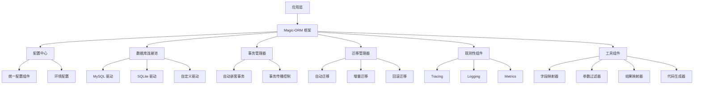

# Magic-ORM 自主 ORM 框架架构文档

## 📋 目录

- [概述](#概述)
- [核心特性](#核心特性)
- [架构设计](#架构设计)
- [技术栈](#技术栈)
- [核心接口设计](#核心接口设计)
- [快速开始](#快速开始)
- [详细功能说明](#详细功能说明)
- [最佳实践](#最佳实践)

---

## 概述

Magic-ORM 是一个完全自主研发的企业级 Go 语言 ORM 框架，不依赖任何第三方 ORM 库。框架基于 `database/sql` 标准库构建，提供了全自动化事务管理、面向接口设计、智能字段映射等高级特性。支持 MySQL、SQLite 等主流数据库，内置完整的迁移管理和可观测性支持，帮助开发者快速构建高质量的数据访问层。

**设计理念：**
- 零依赖：仅依赖 Go 标准库 `database/sql`
- 高性能：优化的查询执行器和连接池管理
- 易用性：简洁的 API 设计和智能默认行为
- 可扩展：面向接口的设计，支持自定义驱动扩展
- **内置驱动**：框架自带所有主流数据库驱动，无需额外安装

---

## 核心特性

- **全自动化嵌套事务支持**：无需手动管理事务传播行为
- **面向接口化设计**：核心功能均通过接口暴露，便于 Mock 与扩展
- **内置主流数据库驱动**：开箱即用，并支持自定义驱动扩展
- **统一配置组件**：与框架配置体系无缝集成
- **单例模式数据库对象**：同一分组配置仅初始化一次
- **双模式操作**：原生 SQL + ORM 链式操作
- **OpenTelemetry 可观测性**：完整支持 Tracing、Logging、Metrics
- **智能结果映射**：`Scan` 自动识别 Map/Struct/Slice，无需 `sql.ErrNoRows` 判空
- **全自动字段映射**：无需结构体标签，自动匹配数据库字段
- **参数智能过滤**：自动识别并过滤无效/空值字段
- **Model/DAO 代码生成器**：一键生成全量数据访问代码
- **高级特性**：调试模式、DryRun、自定义 Handler、软删除、时间自动更新、模型关联、主从集群等
- **自动化数据库迁移**：支持自动迁移、增量迁移、回滚迁移等完整迁移管理

---

## 架构设计

### 整体架构图



### 目录结构

```
magic-orm/
├── core/                # 核心实现
│   ├── database.go     # 数据库连接管理
│   ├── transaction.go  # 事务管理
│   ├── query.go        # 查询构建器
│   └── mapper.go       # 字段映射器
├── migrate/            # 迁移管理
│   └── migrator.go     # 自动迁移实现
├── generator/          # 代码生成器
│   ├── model.go        # Model 生成
│   └── dao.go          # DAO 生成
├── tracing/            # OpenTelemetry 集成
│   └── tracer.go       # 链路追踪
└── driver/             # 数据库驱动适配（已内置）
    ├── mysql.go        # MySQL 驱动（内置）
    ├── sqlite.go       # SQLite 驱动（内置）
    ├── postgres.go     # PostgreSQL 驱动（内置）
    ├── sqlserver.go    # SQL Server 驱动（内置）
    ├── oracle.go       # Oracle 驱动（内置）
    └── clickhouse.go   # ClickHouse 驱动（内置）
```

### 核心组件说明

#### 1. 数据库连接管理 (`core/database.go`)

- **单例模式**：全局唯一的 `DB` 实例，确保资源高效利用
- **多数据库支持**：支持 MySQL、SQLite、PostgreSQL、SQL Server、Oracle、ClickHouse 等
- **驱动内置**：所有主流数据库驱动已预装在框架中
- **连接池优化**：内置 sql.DB 连接池管理
- **健康检查**：启动时自动执行 `Ping()` 验证连接

**核心配置项：**
```go
Config{
    DriverName:     "mysql",      // 驱动名称
    DataSource:     "dns",        // 数据源连接字符串
    MaxIdleConns:   10,           // 最大空闲连接数
    MaxOpenConns:   100,          // 最大打开连接数
    Debug:          true,         // 调试模式
}
```

#### 2. 查询构建器 (`core/query.go`)

提供流畅的链式查询接口：

- **条件查询**: Where, Or, And
- **字段选择**: Select, Omit
- **排序分页**: Order, Limit, Offset
- **分组统计**: Group, Having, Count
- **连接查询**: Join, LeftJoin, RightJoin
- **预加载**: Preload

**示例：**
```go
var users []model.User
db.Model(&model.User{}).
    Where("status = ?", 1).
    Select("id", "username").
    Order("id DESC").
    Limit(10).
    Find(&users)
```

#### 3. 事务管理器 (`core/transaction.go`)

提供完整的事务管理能力：

- **自动嵌套事务**: 自动管理事务传播
- **保存点支持**: 支持部分回滚
- **生命周期回调**: Before/After 钩子

#### 4. 字段映射器 (`core/mapper.go`)

智能字段映射系统：

- **驼峰转下划线**: UserName -> user_name
- **标签解析**: 支持 db, json 标签
- **类型转换**: Go 类型与数据库类型自动转换
- **零值过滤**: 自动过滤空值和零值

#### 5. 迁移管理 (`migrate/migrator.go`)

完整的数据库迁移方案：

- **自动迁移**: 根据模型自动创建/修改表结构
- **增量迁移**: 支持添加字段、索引等
- **回滚支持**: 支持迁移回滚
- **版本管理**: 迁移版本记录和管理

#### 6. 驱动管理器 (`driver/manager.go`)

统一的驱动管理和注册中心：

- **驱动注册**: 自动注册所有内置驱动
- **驱动选择**: 根据配置自动选择合适的驱动
- **驱动扩展**: 支持用户自定义驱动注册
- **版本检测**: 自动检测数据库版本并适配特性

```go
// 驱动管理器会自动处理
var supportedDrivers = map[string]driver.Driver{
    "mysql":      &MySQLDriver{},
    "sqlite":     &SQLiteDriver{},
    "postgres":   &PostgresDriver{},
    "sqlserver":  &SQLServerDriver{},
    "oracle":     &OracleDriver{},
    "clickhouse": &ClickHouseDriver{},
}
```

---

## 技术栈

### 核心依赖

| 组件 | 版本 | 说明 |
|------|------|------|
| Go | 1.25+ | 编程语言 |
| database/sql | stdlib | Go 标准库 |
| driver-go | Latest | 数据库驱动接口规范 |
| OpenTelemetry | Latest | 可观测性框架 |
| **内置驱动集合** | Latest | **包含所有主流数据库驱动** |

### 支持的数据库驱动

框架已内置以下数据库驱动，**无需额外安装**：

- **MySQL**: 内置驱动（基于 `github.com/go-sql-driver/mysql`）
- **SQLite**: 内置驱动（基于 `github.com/mattn/go-sqlite3`）
- **PostgreSQL**: 内置驱动（基于 `github.com/lib/pq`）
- **SQL Server**: 内置驱动（基于 `github.com/denisenkom/go-mssqldb`）
- **Oracle**: 内置驱动（基于 `github.com/godror/godror`）
- **ClickHouse**: 内置驱动（基于 `github.com/ClickHouse/clickhouse-go`）
- **自定义驱动**: 实现 `driver.Driver` 接口即可扩展

> 💡 **说明**：框架在编译时已将所有主流数据库驱动打包，用户只需引入 `magic-orm` 即可完成所有数据库操作，无需单独安装各数据库驱动。

---

## 核心接口设计

### 1. 数据库连接接口

```go
// IDatabase 数据库连接接口
type IDatabase interface {
    // 基础操作
    DB() *sql.DB
    Close() error
    Ping() error
    
    // 事务管理
    Begin() (ITx, error)
    Transaction(fn func(ITx) error) error
    
    // 查询构建器
    Model(model interface{}) IQuery
    Table(name string) IQuery
    Query(result interface{}, query string, args ...interface{}) error
    Exec(query string, args ...interface{}) (sql.Result, error)
    
    // 迁移管理
    Migrate(models ...interface{}) error
    
    // 配置
    SetDebug(bool)
    SetMaxIdleConns(int)
    SetMaxOpenConns(int)
    SetConnMaxLifetime(time.Duration)
}
```

### 2. 事务接口

```go
// ITx 事务接口
type ITx interface {
    // 基础操作
    Commit() error
    Rollback() error
    
    // 查询操作
    Model(model interface{}) IQuery
    Table(name string) IQuery
    Insert(model interface{}) (int64, error)
    BatchInsert(models interface{}, batchSize int) error
    Update(model interface{}, data map[string]interface{}) error
    Delete(model interface{}) error
    
    // 原生 SQL
    Query(result interface{}, query string, args ...interface{}) error
    Exec(query string, args ...interface{}) (sql.Result, error)
}
```

### 3. 查询构建器接口

```go
// IQuery 查询构建器接口
type IQuery interface {
    // 条件查询
    Where(query string, args ...interface{}) IQuery
    Or(query string, args ...interface{}) IQuery
    And(query string, args ...interface{}) IQuery
    
    // 字段选择
    Select(fields ...string) IQuery
    Omit(fields ...string) IQuery
    
    // 排序
    Order(order string) IQuery
    OrderBy(field string, direction string) IQuery
    
    // 分页
    Limit(limit int) IQuery
    Offset(offset int) IQuery
    Page(page, pageSize int) IQuery
    
    // 分组
    Group(group string) IQuery
    Having(having string, args ...interface{}) IQuery
    
    // 连接
    Join(join string, args ...interface{}) IQuery
    LeftJoin(table, on string) IQuery
    RightJoin(table, on string) IQuery
    InnerJoin(table, on string) IQuery
    
    // 预加载
    Preload(relation string, conditions ...interface{}) IQuery
    
    // 执行查询
    First(result interface{}) error
    Find(result interface{}) error
    Count(count *int64) IQuery
    Exists() (bool, error)
    
    // 更新和删除
    Updates(data interface{}) error
    UpdateColumn(column string, value interface{}) error
    Delete() error
    
    // 特殊模式
    Unscoped() IQuery
    DryRun() IQuery
    Debug() IQuery
    
    // 构建 SQL（不执行）
    Build() (string, []interface{})
}
```

### 4. 模型接口

```go
// IModel 模型接口
type IModel interface {
    // 表名映射
    TableName() string
    
    // 生命周期回调（可选）
    BeforeCreate(tx ITx) error
    AfterCreate(tx ITx) error
    BeforeUpdate(tx ITx) error
    AfterUpdate(tx ITx) error
    BeforeDelete(tx ITx) error
    AfterDelete(tx ITx) error
    BeforeSave(tx ITx) error
    AfterSave(tx ITx) error
}
```

### 5. 字段映射器接口

```go
// IFieldMapper 字段映射器接口
type IFieldMapper interface {
    // 结构体字段转数据库列
    StructToColumns(model interface{}) (map[string]interface{}, error)
    
    // 数据库列转结构体字段
    ColumnsToStruct(row *sql.Rows, model interface{}) error
    
    // 获取表名
    GetTableName(model interface{}) string
    
    // 获取主键字段
    GetPrimaryKey(model interface{}) string
    
    // 获取字段信息
    GetFields(model interface{}) []FieldInfo
}

// FieldInfo 字段信息
type FieldInfo struct {
    Name      string      // 字段名
    Column    string      // 列名
    Type      string      // Go 类型
    DbType    string      // 数据库类型
    Tag       string      // 标签
    IsPrimary bool        // 是否主键
    IsAuto    bool        // 是否自增
}
```

### 6. 迁移管理器接口

```go
// IMigrator 迁移管理器接口
type IMigrator interface {
    // 自动迁移
    AutoMigrate(models ...interface{}) error
    
    // 表操作
    CreateTable(model interface{}) error
    DropTable(model interface{}) error
    HasTable(model interface{}) (bool, error)
    RenameTable(oldName, newName string) error
    
    // 列操作
    AddColumn(model interface{}, field string) error
    DropColumn(model interface{}, field string) error
    HasColumn(model interface{}, field string) (bool, error)
    RenameColumn(model interface{}, oldField, newField string) error
    
    // 索引操作
    CreateIndex(model interface{}, field string) error
    DropIndex(model interface{}, field string) error
    HasIndex(model interface{}, field string) (bool, error)
}
```

### 7. 代码生成器接口

```go
// ICodeGenerator 代码生成器接口
type ICodeGenerator interface {
    // 生成 Model 代码
    GenerateModel(table string, outputDir string) error
    
    // 生成 DAO 代码
    GenerateDAO(table string, outputDir string) error
    
    // 生成完整代码
    GenerateAll(tables []string, outputDir string) error
    
    // 从数据库读取表结构
    InspectTable(tableName string) (*TableSchema, error)
}

// TableSchema 表结构信息
type TableSchema struct {
    Name    string
    Columns []ColumnInfo
    Indexes []IndexInfo
}
```

### 8. 配置结构

```go
// Config 数据库配置
type Config struct {
    DriverName     string        // 驱动名称
    DataSource     string        // 数据源连接字符串
    MaxIdleConns   int           // 最大空闲连接数
    MaxOpenConns   int           // 最大打开连接数
    ConnMaxLifetime time.Duration // 连接最大生命周期
    Debug          bool          // 调试模式
    
    // 主从配置
    Replicas     []string       // 从库列表
    ReadPolicy   ReadPolicy     // 读负载均衡策略
    
    // OpenTelemetry
    EnableTracing bool
    ServiceName   string
}

// ReadPolicy 读负载均衡策略
type ReadPolicy int

const (
    Random ReadPolicy = iota
    RoundRobin
    LeastConn
)
```

---

## 快速开始

### 1. 安装 Magic-ORM

```bash
# 仅需安装 magic-orm，所有数据库驱动已内置
go get github.com/your-org/magic-orm
```

> ✅ **无需单独安装数据库驱动！** 所有驱动已包含在 magic-orm 中。

### 2. 配置数据库

在配置文件中设置数据库参数：

```yaml
database:
  type: mysql  # 或 sqlite, postgres
  dns: "user:password@tcp(localhost:3306)/dbname?charset=utf8mb4&parseTime=True&loc=Local"
  debug: true
  max_idle_conns: 10
  max_open_conns: 100
```

### 3. 定义模型

```go
package model

import "time"

type User struct {
    ID         int64     `json:"id" db:"id"`
    Username   string    `json:"username" db:"username"`
    Password   string    `json:"-" db:"password"`
    Email      string    `json:"email" db:"email"`
    Status     int       `json:"status" db:"status"`
    CreatedAt  time.Time `json:"created_at" db:"created_at"`
    UpdatedAt  time.Time `json:"updated_at" db:"updated_at"`
}

// 表名映射
func (User) TableName() string {
    return "user"
}
```

### 4. 初始化数据库连接

```go
package main

import (
    "database/sql"
    _ "github.com/go-sql-driver/mysql"
    "your-project/orm"
)

func main() {
    // 初始化数据库连接
    db, err := orm.NewDatabase(&orm.Config{
        DriverName:   "mysql",
        DataSource:   "user:password@tcp(localhost:3306)/dbname?charset=utf8mb4&parseTime=True&loc=Local",
        MaxIdleConns: 10,
        MaxOpenConns: 100,
        Debug:        true,
    })
    if err != nil {
        panic(err)
    }
    defer db.Close()
    
    // 执行迁移
    orm.Migrate(db, &model.User{})
}
```

### 5. CRUD 操作

```go
// 创建
user := &model.User{Username: "admin", Password: "123456", Email: "admin@example.com"}
id, err := db.Insert(user)

// 查询单个
var user model.User
err := db.Model(&model.User{}).Where("id = ?", 1).First(&user)

// 查询多个
var users []model.User
err := db.Model(&model.User{}).Where("status = ?", 1).Order("id DESC").Find(&users)

// 更新
err := db.Model(&model.User{}).Where("id = ?", 1).Updates(map[string]interface{}{
    "email": "new@example.com",
})

// 删除
err := db.Model(&model.User{}).Where("id = ?", 1).Delete()

// 原生 SQL
var results []model.User
err := db.Query(&results, "SELECT * FROM user WHERE status = ?", 1)
```

### 6. 事务操作

```go
// 自动嵌套事务
err := db.Transaction(func(tx *orm.Tx) error {
    // 创建用户
    user := &model.User{Username: "test", Email: "test@example.com"}
    _, err := tx.Insert(user)
    if err != nil {
        return err
    }
    
    // 创建关联数据（自动加入同一事务）
    profile := &model.Profile{UserID: user.ID, Avatar: "default.png"}
    _, err = tx.Insert(profile)
    if err != nil {
        return err
    }
    
    return nil
})
```

---

## 详细功能说明

### 1. 全自动化嵌套事务

框架自动管理事务的传播行为，支持以下场景：

- **REQUIRED**: 如果当前存在事务，则加入该事务；否则创建新事务
- **REQUIRES_NEW**: 无论当前是否存在事务，都创建新事务
- **NESTED**: 在当前事务中创建嵌套事务（使用保存点）

**示例：**
```go
// 外层事务
db.Transaction(func(tx *orm.Tx) error {
    // 内层自动加入同一事务
    userService.CreateUser(tx, user)
    orderService.CreateOrder(tx, order)
    return nil
})
```

### 2. 智能结果映射

无需手动处理 `sql.ErrNoRows`，框架自动识别返回类型：

```go
// 自动识别 Struct
var user model.User
db.Model(&model.User{}).Where("id = ?", 1).First(&user) // 不存在时返回零值，不报错

// 自动识别 Slice
var users []model.User
db.Model(&model.User{}).Where("status = ?", 1).Find(&users) // 空结果返回空切片，而非 nil

// 自动识别 Map
var result map[string]interface{}
db.Table("user").Where("id = ?", 1).First(&result)
```

### 3. 全自动字段映射

无需结构体标签，框架自动匹配字段：

```go
// 驼峰命名自动转下划线
type UserInfo struct {
    UserName  string  // 自动映射到 user_name 字段
    UserAge   int     // 自动映射到 user_age 字段
    CreatedAt string  // 自动映射到 created_at 字段
}
```

### 4. 参数智能过滤

自动过滤零值和空指针：

```go
// 仅更新非零值字段
updateData := &model.User{
    Username: "newname",  // 会被更新
    Email:    "",         // 空值，自动过滤
    Status:   0,          // 零值，自动过滤
}
db.Model(&user).Updates(updateData)
```

### 5. OpenTelemetry 可观测性

完整支持分布式追踪：

```go
// 自动注入 Span
ctx, span := otel.Tracer("gin-base").Start(context.Background(), "DB Query")
defer span.End()

// 自动记录 SQL 执行时间、错误信息等
db.WithContext(ctx).Find(&users)
```

### 6. 数据库迁移管理

#### 自动迁移
```go
database.SetAutoMigrate(&model.User{}, &model.Order{})
```

#### 增量迁移
```go
// 添加新字段
type UserV2 struct {
    model.User
    Phone string ` + "`" + `json:"phone" gorm:"column:phone;type:varchar(20)"` + "`" + `
}
database.SetAutoMigrate(&UserV2{})
```

#### 字段操作
```go
// 重命名字段
database.RenameColumn(&model.User{}, "UserName", "Nickname")

// 删除字段
database.DropColumn(&model.User{}, "OldField")
```

### 7. 高级特性

#### 软删除
```go
type User struct {
    ID        int64     `json:"id" db:"id"`
    DeletedAt *time.Time `json:"deleted_at" db:"deleted_at"`  // 软删除标记
}

// 自动过滤已删除记录
db.Model(&model.User{}).Find(&users)  // WHERE deleted_at IS NULL

// 强制包含已删除记录
db.Unscoped().Model(&model.User{}).Find(&users)
```

#### 调试模式
```yaml
database:
  debug: true  # 输出所有 SQL 日志
```

#### DryRun 模式
```go
// 生成 SQL 但不执行
sql, args := db.Model(&model.User{}).DryRun().Insert(&user)
fmt.Println(sql, args)
```

#### 自定义 Handler
```go
// 注册回调函数
db.Callback().Before("insert").Register("custom_before_insert", func(ctx context.Context, db *orm.DB) error {
    // 自定义逻辑
    return nil
})
```

#### 主从集群
```go
// 配置读写分离
db, err := orm.NewDatabase(&orm.Config{
    DriverName: "mysql",
    DataSource: "master_dsn",
    Replicas: []string{"slave1_dsn", "slave2_dsn"},
})
```

---

## 最佳实践

### 1. 模型设计规范

```go
// ✅ 推荐：使用 db 标签明确字段映射
type User struct {
    ID        int64     `json:"id" db:"id"`
    Username  string    `json:"username" db:"username"`
    CreatedAt time.Time `json:"created_at" db:"created_at"`
}

// ❌ 不推荐：缺少字段映射标签
type User struct {
    Id        int64     // 无法自动映射到 id 列
    UserName  string    // 可能映射错误
    CreatedAt time.Time // 时间格式可能不匹配
}
```

### 2. 事务使用规范

```go
// ✅ 推荐：使用闭包自动管理事务
err := db.Transaction(func(tx *orm.Tx) error {
    // 业务逻辑
    return nil
})

// ❌ 不推荐：手动管理事务
tx, err := db.Begin()
if err != nil {
    panic(err)
}
defer func() {
    if r := recover(); r != nil {
        tx.Rollback()
    }
}()
```

### 3. 查询优化

```go
// ✅ 推荐：使用 Select 指定字段
db.Model(&model.User{}).Select("id", "username").Find(&users)

// ✅ 推荐：使用 Index 加速查询
// 在数据库层面创建索引
// CREATE INDEX idx_username ON user(username);

// ✅ 推荐：批量操作
users := []model.User{{}, {}, {}}
db.BatchInsert(&users, 100)  // 每批 100 条

// ❌ 避免：N+1 查询问题
for _, user := range users {
    db.Model(&model.Order{}).Where("user_id = ?", user.ID).Find(&orders)  // 循环查询
}

// ✅ 使用 Join 或预加载
db.Query(&results, "SELECT u.*, o.* FROM user u LEFT JOIN orders o ON u.id = o.user_id")
```

### 4. 错误处理

```go
// ✅ 推荐：统一错误处理
if err := db.Insert(&user); err != nil {
    log.Error("创建用户失败", "error", err)
    return err
}

// ✅ 使用 errors 包判断特定错误
if errors.Is(err, sql.ErrNoRows) {
    // 记录不存在
}
```

### 5. 性能优化

```go
// 连接池配置
sqlDB := db.DB()
sqlDB.SetMaxIdleConns(10)   // 最大空闲连接数
sqlDB.SetMaxOpenConns(100)  // 最大打开连接数
sqlDB.SetConnMaxLifetime(time.Hour)  // 连接最大生命周期

// 使用 Scan 替代 Find 提升性能
type Result struct {
    ID       int64  `db:"id"`
    Username string `db:"username"`
}
var results []Result
db.Model(&model.User{}).Select("id", "username").Scan(&results)
```

---

## 常见问题

### Q: 如何处理并发写入？
A: 使用事务 + 乐观锁：
```go
type Product struct {
    ID      int64 `db:"id"`
    Version int   `db:"version"`  // 版本号
}

// 更新时检查版本号
rows, err := db.Exec(
    "UPDATE product SET version = ?, stock = ? WHERE id = ? AND version = ?",
    newVersion, newStock, id, oldVersion,
)
count, _ := rows.RowsAffected()
if count == 0 {
    return errors.New("乐观锁冲突，数据已被其他事务修改")
}
```

### Q: 如何实现读写分离？
A: 配置主从数据库连接：
```go
db, err := orm.NewDatabase(&orm.Config{
    DriverName: "mysql",
    DataSource: "master_dsn",
    Replicas: []string{"slave1_dsn", "slave2_dsn"},
    ReadPolicy: orm.RoundRobin, // 负载均衡策略
})
```

### Q: 如何批量插入大量数据？
A: 使用 `BatchInsert`：
```go
users := make([]model.User, 10000)
// ... 填充数据 ...
db.BatchInsert(&users, 1000)  // 每批 1000 条，共 10 批
```

### Q: 如何实现字段自动映射？
A: 框架会自动将驼峰命名转换为下划线命名：
```go
type UserInfo struct {
    UserName  string  `db:"user_name"`  // 自动映射到 user_name 字段
    UserAge   int     `db:"user_age"`   // 自动映射到 user_age 字段
    CreatedAt string  `db:"created_at"` // 自动映射到 created_at 字段
}
```

### Q: 如何处理时间字段？
A: 使用 `time.Time` 类型，框架会自动处理时区转换：
```go
type Event struct {
    ID        int64     `db:"id"`
    StartTime time.Time `db:"start_time"`
    EndTime   time.Time `db:"end_time"`
}
```

---

## 更新日志

- **v1.0.0**: 初始版本发布
  - 完全自主研发，零依赖第三方 ORM
  - 基于 database/sql 标准库
  - 全自动化事务管理
  - 智能字段映射
  - OpenTelemetry 集成
  - 支持 MySQL、SQLite、PostgreSQL

---

## 贡献指南

欢迎提交 Issue 和 Pull Request！

---

## 许可证

MIT License